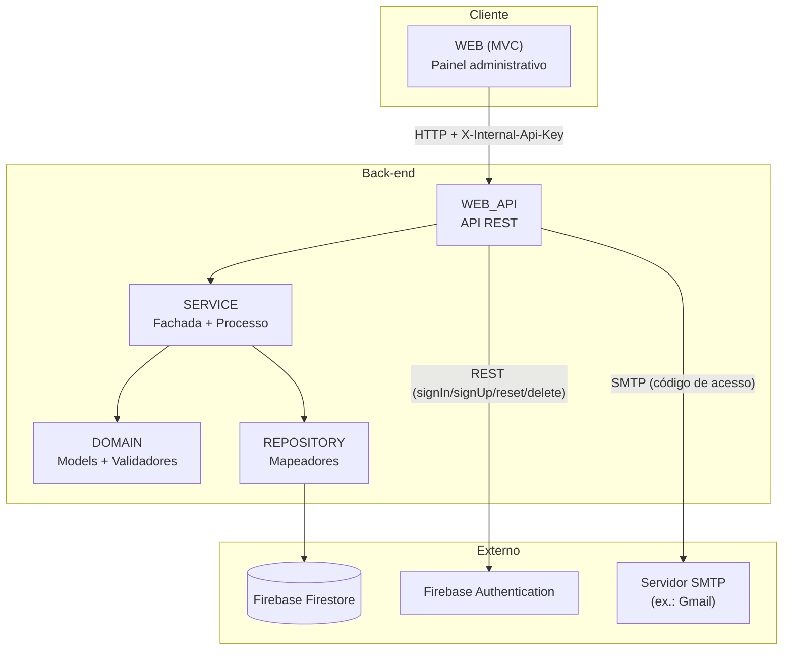

# IValid

Sistema de gestão de validade de produtos para supermercados, com o objetivo de reduzir o desperdício de alimentos ao identificar automaticamente produtos próximos do vencimento e sugerir descontos progressivos para incentivar sua venda.

Este documento descreve a visão geral do sistema e sua arquitetura técnica.

## Sumário

- [Visão geral](#visão-geral)
- [Stack tecnológica](#stack-tecnológica)
- [Arquitetura](#arquitetura)
- [Camadas do sistema](#camadas-do-sistema)
- [Comunicação entre WEB e WEB_API](#comunicação-entre-web-e-web_api)
- [Multiloja: um login por supermercado](#multiloja-um-login-por-supermercado)
- [Autenticação e segurança](#autenticação-e-segurança)
- [API do aplicativo mobile](#api-do-aplicativo-mobile)
- [Modelo de dados (Firestore)](#modelo-de-dados-firestore)
- [Estrutura de pastas](#estrutura-de-pastas)

## Visão geral

O IValid é um painel administrativo web multiloja voltado para supermercados: cada supermercado cadastrado tem seus próprios produtos, funcionários e configurações, completamente isolados dos demais. O sistema permite cadastrar produtos com preço, quantidade em estoque e data de vencimento, e calcula automaticamente:

- o status de validade do produto (crítico, em atenção, na validade ou vencido);
- o percentual de desconto sugerido para cada status;
- o preço promocional resultante.

Esses limiares (quantos dias antes do vencimento cada status começa) e os percentuais de desconto de cada faixa são configuráveis pelo próprio administrador, na tela de Configurações — não são valores fixos no código, e cada supermercado tem a sua própria configuração.

Na listagem de produtos, itens sem estoque são sempre exibidos por último, independentemente do status de validade — afinal, não há mais o que vender. Produtos vencidos seguem a mesma lógica de "vão para o final" dentro do grupo de itens que ainda têm estoque.

O projeto é acadêmico e cobre o painel administrativo e a API. A API também expõe as rotas `api/app/*`, consumidas pelo aplicativo mobile (Flutter, em repositório próprio), descritas em [API do aplicativo mobile](#api-do-aplicativo-mobile).

## Stack tecnológica

| Camada | Tecnologia |
|---|---|
| Front-end / painel administrativo | ASP.NET Core MVC (C#) |
| API | ASP.NET Core Web API (C#) |
| Banco de dados | Firebase Firestore (NoSQL) |
| Autenticação do administrador | Firebase Authentication (via API REST) |
| Autenticação de funcionários | Hash de senha local (PBKDF2-SHA256), sem Firebase |
| Sessão do painel | Cookie Authentication (ASP.NET Core) |
| Envio de e-mail | SMTP (`System.Net.Mail`), ex.: Gmail |
| Validação de regras de negócio | FluentValidation |
| Documentação interativa da API | Scalar (OpenAPI) |

## Arquitetura

O sistema segue uma arquitetura em camadas, com responsabilidades bem separadas entre cadastro/validação de dados, regras de negócio e exposição via API/interface web.



A `WEB` nunca acessa o Firestore, o Firebase Authentication ou a lógica de negócio diretamente — toda operação, incluindo login, cadastro e recuperação de senha, passa pela `WEB_API`, que por sua vez delega para as camadas internas (`SERVICE`, `DOMAIN`, `REPOSITORY`) ou conversa com os serviços externos (Firebase Authentication, SMTP). Essa separação permite, por exemplo, que a mesma API venha a ser consumida futuramente por um aplicativo mobile, sem duplicar regra de negócio.

## Camadas do sistema

**DOMAIN** — projeto central de domínio, sem dependência de infraestrutura. Contém os `Models` (entidades como `ProdutoModel`, `ConfiguracaoModel`, `UsuarioModel`, `SupermercadoModel`, `FuncionarioModel`) e os `Validadores`, escritos com FluentValidation, que definem as regras de negócio de cada entidade (ex.: nome obrigatório, preço maior que zero, data de vencimento não pode estar no passado). Todo validador herda de uma classe abstrata comum (`ValidadorAbstrato<T>`), que padroniza os métodos de inclusão, atualização e exclusão.

**Excecoes** — projeto compartilhado com os tipos de exceção usados em todo o sistema (`IValidExcecao`, `CodigoExcecao`, `ExcecaoDetalhes`), garantindo que erros de negócio sejam tratados de forma consistente entre a API e o painel.

**REPOSITORY** — camada de acesso a dados. Cada entidade tem um `Mapeador` (ex.: `ProdutoMapeador`, `ConfiguracaoMapeador`, `SupermercadoMapeador`, `FuncionarioMapeador`) responsável por ler e escrever diretamente no Firestore, implementando uma interface própria (ex.: `IProdutoMapeador`). Nenhuma outra camada acessa o Firestore diretamente.

**SERVICE** — camada de regra de negócio, dividida em dois papéis:
- `Processo`: lógica de negócio propriamente dita. Exemplos: `ProdutoProcesso` calcula o status de validade, o percentual de desconto e o preço promocional de cada produto, e ordena a listagem colocando primeiro os itens com estoque (do mais urgente ao menos urgente) e, por último, os sem estoque e os vencidos; `SupermercadoProcesso` gera o código de acesso único de cada loja; `FuncionarioProcesso` faz o hash e a verificação de senha dos funcionários; `EmailProcesso` envia o e-mail com o código de acesso via SMTP.
- `Fachada`: orquestra `Processo` e `Validador` juntos, garantindo que nenhuma operação de cadastro/atualização/exclusão seja executada sem antes passar pela validação de domínio. A `UsuarioFachada`, por exemplo, orquestra a criação do Supermercado, do Administrador e o envio do e-mail com o código de acesso em uma única operação de registro.

**WEB_API** — API REST que expõe as operações do sistema (`api/Produto`, `api/Configuracao`, `api/Usuario`, `api/Pedido`, `api/Funcionario`). É protegida por um middleware de chave interna (`X-Internal-Api-Key`), já que seu uso é restrito à `WEB` — não é uma API pública. É também a única camada que conversa com o Firebase Authentication e com o servidor SMTP.

**WEB** — painel administrativo (MVC), consumido pelo usuário final (administrador ou funcionário do supermercado). Não contém regra de negócio: cada ação do painel monta a requisição e delega para a `WEB_API`, tratando a resposta (sucesso, erro de validação, erro de conexão) para exibir ao usuário. O acesso às telas é restrito por perfil (`[Authorize(Roles = "...")]`): Produtos é liberado para Administrador, Gerente e Operador de Estoque; Pedidos para Administrador, Gerente e Atendente; Configurações e a gestão de Funcionários ficam restritas ao Administrador.

## Comunicação entre WEB e WEB_API

A `WEB` se comunica com a `WEB_API` exclusivamente via HTTP, usando um `HttpClient` nomeado (`IValidApi`) configurado com a URL base da API e um cabeçalho fixo de autenticação interna (`X-Internal-Api-Key`). A `WEB_API` valida esse cabeçalho em um middleware antes de processar qualquer requisição (exceto as rotas de documentação do Scalar/OpenAPI), rejeitando com `401` qualquer chamada sem a chave correta.

Esse mecanismo existe porque as rotas administrativas da `WEB_API` não são públicas: são de uso exclusivo da `WEB`. As rotas do aplicativo (`api/app/*`) não usam essa chave; elas são autenticadas pelo token do Firebase do cliente (veja [API do aplicativo mobile](#api-do-aplicativo-mobile)).

Como o sistema é multiloja, praticamente toda chamada da `WEB` para a `WEB_API` sobre produtos, pedidos, configurações e funcionários inclui o `supermercadoId` do usuário logado como query string, extraído da claim `SupermercadoId` do cookie de autenticação. A `WEB_API` usa esse valor para filtrar e validar a posse de cada recurso antes de retorná-lo ou alterá-lo.

## Multiloja: um login por supermercado

Cada supermercado cadastrado é uma loja isolada dentro do sistema, identificada por um **Código de Acesso** único (gerado automaticamente a partir do nome da loja no momento do cadastro, com um sufixo numérico caso já exista outro igual). Um mesmo proprietário com duas lojas físicas cria duas contas distintas — uma por supermercado — cada uma com seu próprio código.

O login é feito em duas etapas, na mesma tela:

1. O usuário informa o **Código da Loja**.
2. O sistema busca os usuários daquela loja (o Administrador dono da conta e os Funcionários ativos) e exibe um seletor; o usuário escolhe seu nome e informa a senha.

Internamente, os dois tipos de usuário são autenticados de formas diferentes, mas convergem para o mesmo resultado (um DTO `ResultadoLoginModel` com nome, perfil e `supermercadoId`), usado para montar as claims do cookie de sessão:

- **Administrador**: autenticado contra o Firebase Authentication (email/senha), como antes. O e-mail correspondente é resolvido a partir do `usuarioId` selecionado, sem que o usuário precise digitá-lo.
- **Funcionário**: autenticado contra um hash de senha (PBKDF2-SHA256) armazenado no próprio Firestore, sem envolver o Firebase Authentication. Funcionários são cadastrados pelo Administrador, com um perfil pré-definido: Gerente, Operador de Estoque ou Atendente.

Isolamento de dados entre lojas:

- `ProdutoModel`, `ConfiguracaoModel`, `UsuarioModel` e `FuncionarioModel` carregam um `SupermercadoId`, usado para filtrar e validar posse em toda operação de leitura/escrita.
- `ConfiguracaoModel` deixou de ser um documento único global (`geral`) e passou a ser um documento por `SupermercadoId` — cada loja tem seus próprios limiares de dias e percentuais de desconto.
- `PedidoModel` criado pela API (`POST api/app/pedidos`) carrega `supermercadoId` e é filtrado diretamente por ele. Pedidos antigos, gravados pelo app direto no Firestore sem esse campo, continuam sendo associados de forma indireta: a API busca os Produtos da loja e filtra os Pedidos cujos itens referenciam algum desses IDs.

## Perfis e permissões

O Administrador (dono da loja) tem acesso total. Os funcionários acessam o painel conforme o **perfil** atribuído a eles, cadastrado em *Perfis e permissões* (só o Administrador vê essa tela e a de Funcionários).

| Permissão | Libera |
|---|---|
| `produtos` | Produtos |
| `pedidos` | Pedidos e mudança de status |
| `financeiro` | Faturamento, lucro e valor em risco no dashboard |
| `configuracoes` | Descontos e dados da loja |
| `categorias` | Categorias |
| `ongs` | ONGs |

- Os perfis ficam na coleção `perfis`, um conjunto por loja. Na primeira vez em que uma loja lista perfis, o sistema cria Gerente (produtos, pedidos, financeiro), Operador de Estoque (produtos) e Atendente (pedidos), com as mesmas permissões que esses papéis tinham quando eram fixos no código.
- Funcionários antigos (com o campo `perfil` texto e sem `perfilId`) são ligados a esses perfis automaticamente; ao serem editados, passam a gravar `perfilId`.
- No login, as permissões do perfil viram claims `Permissao` no cookie, e cada tela usa uma policy com o nome da permissão. Por isso, mudanças em um perfil só valem no próximo login do funcionário.
- Um perfil em uso por funcionários não pode ser excluído, e o nome "Administrador" é reservado.

## Autenticação e segurança

O acesso ao painel administrativo é protegido em duas frentes:

- **Sessão do painel**: após o login, a `WEB` mantém a sessão do usuário via cookie de autenticação do ASP.NET Core, configurado com `HttpOnly`, `SecurePolicy = Always` e `SameSite = Strict`. Um filtro global de autorização exige login em todas as páginas do painel, com exceção explícita das telas de login, cadastro e recuperação de senha. Dentro do painel, o acesso a cada tela é restrito por perfil (`ClaimTypes.Role`), como descrito na seção de camadas.
- **Identidade do usuário**: para Administradores, a validação de credenciais é feita contra o Firebase Authentication. Para Funcionários, contra um hash local (PBKDF2-SHA256, com `CryptographicOperations.FixedTimeEquals` na comparação).

O cadastro não exige mais um código de convite: qualquer pessoa pode se cadastrar, criando ao mesmo tempo sua conta de Administrador e o Supermercado (com nome, CNPJ e endereço). Ao final do cadastro, o Código de Acesso da loja é enviado por e-mail — não é exibido na tela — e é ele que identifica a loja em todo login futuro. Caso a criação dos dados no Firestore falhe depois que a conta já foi criada no Firebase Authentication, a API reverte (exclui) automaticamente a conta órfã, evitando que o e-mail fique bloqueado para novas tentativas de cadastro.

Segredos (chave de API interna, credencial de acesso ao Firebase, credenciais de e-mail SMTP) ficam fora do controle de versão, em arquivos de configuração locais (`appsettings.Development.json` e a pasta `Chave/`), listados no `.gitignore`.

## API do aplicativo mobile

O aplicativo consome as rotas `api/app/*`. A documentação interativa (Scalar) fica em `/scalar` no ambiente de desenvolvimento e já mostra os esquemas de autenticação de cada rota.

### Autenticação

- O app envia `Authorization: Bearer <idToken>`, obtido com `FirebaseAuth.instance.currentUser!.getIdToken()`.
- A API valida o token com o emissor `https://securetoken.google.com/{ProjectId}` (JWT Bearer). O `uid` do token identifica o cliente; nenhuma rota recebe o id do usuário pelo corpo ou pela URL.
- As rotas de vitrine são públicas (somente leitura). As demais exigem o token.
- O middleware da chave interna ignora `api/app/*`; todas as outras rotas continuam exigindo `X-Internal-Api-Key`.

### Rotas

| Método | Rota | Descrição |
|---|---|---|
| GET | `api/app/produtos` | Vitrine paginada. Filtros: `categoriaId`, `busca`, `supermercadoId`, `status`, `ordem` (`vencimento`, `menorPreco`, `maiorDesconto`, `nome`), `pagina`, `tamanhoPagina`. Sem vencidos nem esgotados; preço e dias calculados na hora |
| GET | `api/app/produtos/ofertas-relampago` | Mesma vitrine, só faixa VERMELHO |
| GET | `api/app/produtos/{id}` | Detalhe (inclui vencidos/esgotados, com `status` e `quantidadeDisponivel`) |
| GET | `api/app/categorias` | Categorias |
| GET | `api/app/supermercados` / `{id}` | Nome, endereço, latitude e longitude da loja |
| GET | `api/app/ongs` | ONGs ativas |
| POST | `api/app/clientes` | Cria o perfil do cliente logado (idempotente) |
| GET / PUT | `api/app/clientes/me` | Perfil, nível de fidelidade, cashback e impacto |
| GET | `api/app/clientes/me/impacto` | Totais de impacto |
| GET | `api/app/clientes/me/favoritos` | Produtos favoritos |
| PUT / DELETE | `api/app/clientes/me/favoritos/{produtoId}` | Adiciona / remove favorito |
| POST | `api/app/clientes/me/dispositivos` | Registra o token FCM do aparelho |
| POST | `api/app/clientes/me/dispositivos/remover` | Remove o token FCM (logout) |
| POST | `api/app/pedidos/validar` | Simula o pedido: preços, cashback aplicável, total e problemas por item |
| POST | `api/app/pedidos` | Cria o pedido (transação: confere estoque e validade, recalcula preços, baixa estoque, debita cashback) |
| GET | `api/app/pedidos` / `{id}` | Pedidos do cliente |
| POST | `api/app/pedidos/{id}/cancelar` | Cancela (só PENDENTE ou CONFIRMADO); devolve estoque e cashback |
| POST | `api/app/pedidos/{id}/pagamento/link` | Gera o link do InfinitePay para pedido `Online` |
| POST | `api/app/pedidos/{id}/pagamento/confirmar` | A API consulta o InfinitePay e só então marca o pedido como pago |

Respostas de erro usam `{ codigo, informacaoAdicional }`: `400` validação, `401` sem token, `403` conta do painel, `404` não encontrado, `409` regra de negócio (estoque, transição de status, pagamento). Quando o pedido tem itens indisponíveis, o `409` traz também `resumo.problemas`.

### Regras do pedido

- Um pedido é de uma única loja. O preço de cada item é sempre calculado pela API (RN01), nunca enviado pelo app.
- Itens têm `origem`: `compra` ou `doacao`. `ongId` é opcional e só vale com itens de doação.
- Cashback: no máximo 15% do subtotal e nunca acima do saldo. O valor pedido acima disso é ajustado.
- Formas de pagamento: `Dinheiro` e `Voucher` (pagos na retirada, pedido nasce CONFIRMADO), `Online` (nasce PENDENTE, com estoque reservado, até a confirmação do InfinitePay) e `Demonstracao` (só com `Pagamento:PermitirDemonstracao = true`). Pedido zerado pelo cashback vira `Cashback` e já nasce pago.
- Pedido `Online` não pago é cancelado automaticamente após `Pagamento:MinutosExpiracaoPedidoPendente` minutos, devolvendo estoque e cashback.
- Status: PENDENTE → CONFIRMADO → SEPARADO → (EM_ROTA) → FINALIZADO, ou CANCELADO. A loja muda o status pelo painel (`PATCH api/Pedido/{id}/status`), e o cliente recebe um push.
- Cashback das doações, contagem de doações e impacto só são creditados quando o pedido é FINALIZADO. Assim, um cancelamento nunca precisa desfazer benefícios.
- Pedido pago online e depois cancelado fica com `estornoPendente = true`; o painel mostra o aviso para a loja estornar.

### Rotinas em segundo plano

O `RotinaDiariaService` roda a cada `Rotinas:IntervaloMinutos` (padrão 15) e:

- cancela pedidos online pendentes expirados;
- uma vez por dia, recalcula `daysValidity`, `newPrice`, `status` e `descricaoPorcentual` dos produtos gravados (compatibilidade com quem ainda lê o Firestore direto);
- uma vez por dia, envia um push para o tópico `ofertas` com a quantidade de produtos que entraram na faixa VERMELHO.

O controle de "uma vez por dia" fica na coleção `rotinas`, para não repetir após reiniciar a API.

### Configuração (`WEB_API/appsettings.json`)

- `Pagamento`: InfiniteTag do recebedor, URL de retorno, modo demonstração e tempo de expiração.
- `Notificacoes`: liga/desliga o FCM e define o tópico de ofertas. O envio usa a mesma credencial de serviço do Firestore (`Firebase:CredentialsPath`).
- `Rotinas`: liga/desliga as rotinas e define o intervalo.
- Para desenvolvimento local com o emulador do Firestore, basta definir `FIRESTORE_EMULATOR_HOST`.

### Regras do Firestore após a migração do app

Enquanto o app ainda grava direto no Firestore, as regras atuais devem ser mantidas. Depois que o app passar a usar só a API, o app não precisa mais escrever em `produtos`, `pedidos` nem nos campos de saldo de `users`. A API usa credencial de serviço e não é afetada pelas regras:

```
rules_version = '2';
service cloud.firestore {
  match /databases/{database}/documents {
    match /{document=**} { allow read, write: if false; }
  }
}
```

## Modelo de dados (Firestore)

O Firestore é usado como banco de dados NoSQL, com as seguintes coleções principais:

- **supermercados** — um documento por loja cadastrada (nome, CNPJ, endereço, código de acesso único). É a unidade de isolamento (a "loja") do sistema.
- **produtos** — um documento por produto cadastrado (nome, marca, categoria, preço, quantidade, data de vencimento, status calculado, percentual de desconto, preço promocional, imagem, `supermercadoId`, `storeName`).
- **users** — um documento por Administrador cadastrado (id aleatório, com `supermercadoId`) e um documento por cliente do app (id = `uid` do Firebase Auth, com nome, endereço, `availableCashback`, `totalDonations`, `impact`, `favoritos` e `fcmTokens`).
- **funcionarios** — um documento por funcionário cadastrado por um Administrador, com nome, hash de senha, perfil (Gerente/Operador de Estoque/Atendente), situação (ativo/inativo) e `supermercadoId`.
- **configuracoes** — um documento por `supermercadoId`, guardando os limiares de dias e os percentuais de desconto usados no cálculo de status dos produtos daquela loja especificamente.
- **pedidos** — criados pela API para o app, com `supermercadoId`, itens com `productId` e `unitPrice`, forma e status de pagamento, cashback usado e ganho, impacto e `origemApi = true`. Pedidos antigos sem `supermercadoId` continuam associados à loja pelos produtos dos itens.
- **categories** — categorias de produto, compartilhadas entre as lojas (`name`, `order`, `icon`).
- **ongs** — ONGs que recebem as doações (`nome`, `cidade`, `descricao`, `urlImagem`, `ativa`).
- **rotinas** — controle de execução diária das rotinas em segundo plano.

## Estrutura de pastas

```
IValid/
├── DOMAIN/           # Models e Validadores (regras de negócio de domínio)
├── Excecoes/         # Tipos de exceção compartilhados
├── REPOSITORY/       # Mapeadores de acesso ao Firestore
├── SERVICE/          # Processo (lógica de negócio) e Fachada (orquestração + validação)
├── WEB_API/          # API REST, consumida pela WEB
├── WEB/              # Painel administrativo (MVC)
└── Chave/            # Credencial do Firebase (fora do controle de versão)
```
