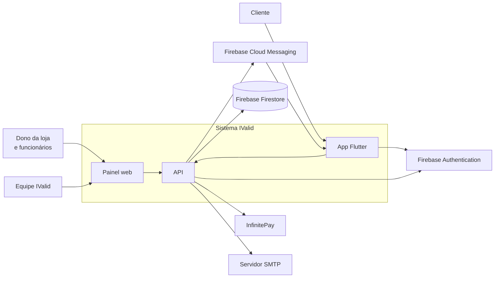
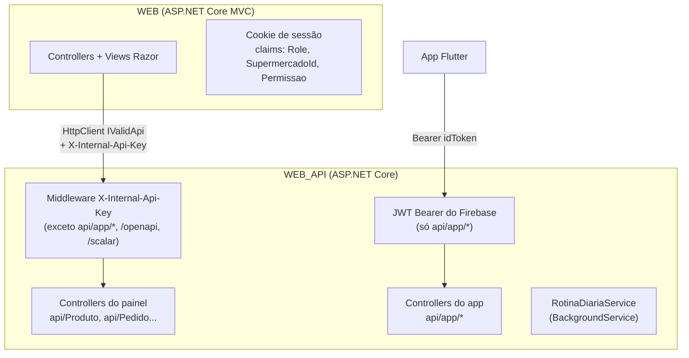
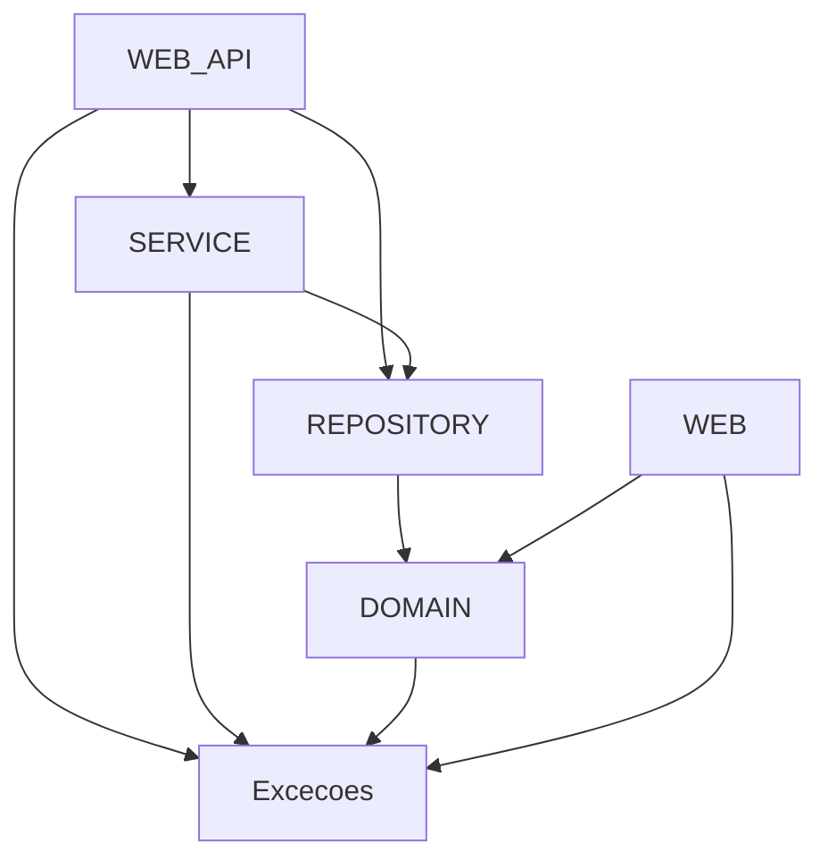
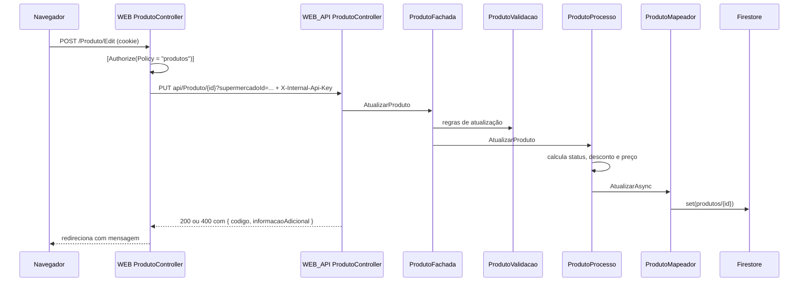

# 02. Arquitetura

## Nível 1: contexto

Quem usa o sistema e com quais serviços externos ele conversa.

## Nível 2: containers

| Container | Projeto | Responsabilidade | Hospedagem |
|---|---|---|---|
| Painel web | `WEB` | Telas MVC, sessão por cookie e autorização por perfil. Não tem regra de negócio nem acesso ao banco. | Render (`ivalid-web`) |
| API | `WEB_API` | Única porta de entrada para os dados. Regras de negócio, integrações e rotinas em segundo plano. | Render (`ivalid-api`) |
| Banco | Firestore | Coleções NoSQL. | Google Cloud |
| App | repositório Flutter | Vitrine, pedidos e perfil do cliente. | Android |

## Nível 3: componentes da API

A solução (`IValid.slnx`) tem seis projetos. As setas indicam as referências declaradas nos `.csproj`. A `WEB_API` referencia o `REPOSITORY` só para registrar os mapeadores na injeção de dependência.

Pacotes principais: `Google.Cloud.Firestore` 4.2, `FluentValidation` 12.1, `FirebaseAdmin` 3.7 (push), `Microsoft.AspNetCore.Authentication.JwtBearer` 10, `Microsoft.AspNetCore.OpenApi` 10 e `Scalar.AspNetCore` 2.14. Todos os projetos usam .NET 10 com `Nullable` habilitado.

| Projeto | Contém | Regra |
|---|---|---|
| `Excecoes` | `IValidExcecao`, `CodigoExcecao`, `ExcecaoDetalhes` | Sem dependências. |
| `DOMAIN` | Models (com atributos do Firestore), validadores FluentValidation e utilitários de regra pura (`StatusPedidoUtil`, `NivelFidelidadeUtil`, `PermissaoUtil`) | Não acessa banco nem rede. |
| `REPOSITORY` | Mapeadores (`IProdutoMapeador`/`ProdutoMapeador` etc.) e `TransacaoMapeador` | Único projeto que fala com o Firestore. |
| `SERVICE` | `Processo` (regras), `Fachada` (orquestra validação e processos), `Integracao` (InfinitePay) e `Opcoes` (configuração tipada) | Não conhece HTTP. |
| `WEB_API` | Controllers, middleware, `Program.cs` (injeção de dependência) e `RotinaDiariaService` | Só traduz HTTP para chamadas da fachada. |
| `WEB` | Controllers MVC, views Razor, `Seguranca/PermissaoExtensions` | Usa os models do `DOMAIN` como DTO. Não referencia `SERVICE` nem `REPOSITORY`. |

A pasta `IValid/` (com `Class1.cs`) é um projeto vazio que sobrou do template e não está na solução.

## Fluxo de uma requisição do painel

Exemplo: o gerente edita um produto.

Pontos importantes:

- O `supermercadoId` vem da claim do cookie, nunca do formulário. A API confere se o recurso pertence a essa loja antes de ler ou alterar.
- Erros de negócio são lançados como `IValidExcecao` com um `CodigoExcecao`. Os controllers mais novos herdam de `ControllerApiBase`, que converte o código em status HTTP (veja [Referência da API](05-api-referencia.md#erros)).

## Fluxo de uma requisição do app

O app autentica no Firebase, recebe um `idToken` e o envia como `Authorization: Bearer`. A API valida o token (emissor `https://securetoken.google.com/{ProjectId}`) e usa o `user_id` do token como identidade do cliente. Nenhuma rota do app recebe o id do usuário pela URL ou pelo corpo.

## Rotinas em segundo plano

`RotinaDiariaService` roda dentro da API a cada `Rotinas:IntervaloMinutos` (padrão 15), começando 30 segundos depois que a API sobe. Em cada execução:

1. Cancela pedidos online pendentes que passaram do prazo de pagamento.
2. Uma vez por dia (fuso `America/Sao_Paulo`), recalcula os campos derivados de todos os produtos.
3. Uma vez por dia, envia um push para o tópico de ofertas.

O controle de "uma vez por dia" fica na coleção `rotinas`, então reiniciar a API não repete a rotina. Detalhes em [Regras de negócio](07-regras-de-negocio.md#rotinas-em-segundo-plano).

**Atenção:** no plano gratuito do Render o serviço "dorme" sem tráfego, e as rotinas param junto.

## Decisões de arquitetura

As decisões que moldaram esta estrutura estão em [ADRs](adr/README.md). As principais:

- [ADR 0001](adr/0001-firestore-como-banco.md): Firestore como banco.
- [ADR 0002](adr/0002-painel-acessa-dados-somente-pela-api.md): o painel só acessa dados pela API, com chave interna.
- [ADR 0005](adr/0005-preco-calculado-pela-api.md): preço sempre calculado pela API.
