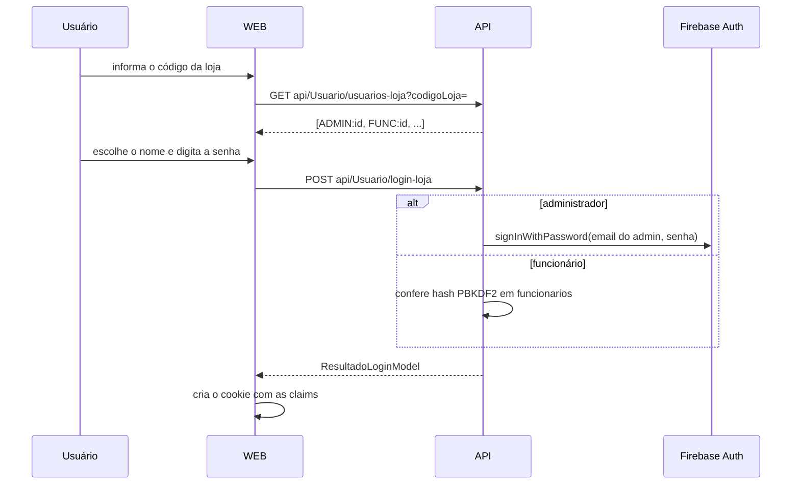

# 06. Painel web

O painel (`WEB`) é um site ASP.NET Core MVC com views Razor. Ele não tem regra de negócio: cada ação chama a API pelo `HttpClient` nomeado `IValidApi` e mostra o resultado. O layout das telas logadas é `Views/Shared/_AdminLayout.cshtml` (Bootstrap 5 e Font Awesome via CDN).

## Login

Existem dois logins, que terminam no mesmo tipo de cookie.

### Login da loja (`/Autenticacao/Login`)

O administrador não digita o e-mail: a API descobre o e-mail pelo id escolhido. O funcionário não tem conta no Firebase.

### Login da plataforma (`/Autenticacao/LoginPlataforma`)

Para a equipe IValid. Pede e-mail e senha, confere se o e-mail está em `Plataforma:EmailsAdministradores` e valida a senha no Firebase Auth. O link fica discreto na tela de login ("Acesso da equipe IValid").

### Cookie de sessão

Claims gravadas em `AutenticacaoController.EntrarAsync`:

| Claim | Valor |
|---|---|
| `Name` | Nome do usuário |
| `Email` | E-mail (vazio para funcionário) |
| `Role` | `Administrador`, `Funcionario` ou `Plataforma` |
| `NameIdentifier` | Id do usuário |
| `SupermercadoId` | Loja do usuário (vazio para `Plataforma`) |
| `NomePerfil` | Nome exibido no menu (ex.: "Gerente") |
| `Permissao` (várias) | Uma por permissão do perfil |

O cookie dura 8 horas com expiração deslizante, e é `HttpOnly`, `Secure` e `SameSite=Strict`. Mudanças no perfil de um funcionário só valem no próximo login, porque as permissões ficam no cookie.

## Perfis e permissões

| Quem | Como é autorizado |
|---|---|
| Administrador da loja | `Role = Administrador`. `TemPermissao` sempre retorna verdadeiro para ele. |
| Funcionário | Claims `Permissao` vindas do perfil. |
| Equipe IValid | `Role = Plataforma`. Não tem `SupermercadoId` nem permissões de loja. |

Permissões de loja (`PermissaoUtil.Todas`):

| Permissão | Libera |
|---|---|
| `produtos` | Tela de produtos |
| `pedidos` | Tela de pedidos e mudança de status |
| `financeiro` | Faturamento, lucro e valor em risco no dashboard |
| `configuracoes` | Descontos e dados da loja |

Cada permissão vira uma *policy* com o mesmo nome (`PermissaoExtensions.AdicionarPoliticasDePermissao`), usada em `[Authorize(Policy = PermissaoUtil.Produtos)]`. O menu lateral usa `User.TemPermissao(...)` para esconder o que o usuário não pode abrir.

Perfis padrão criados na primeira vez que a loja lista perfis:

| Perfil | Permissões |
|---|---|
| Gerente | produtos, pedidos, financeiro |
| Operador de Estoque | produtos |
| Atendente | pedidos |

Regras: um perfil em uso não pode ser excluído, e o nome "Administrador" é reservado. Funcionários antigos sem `perfilId` são ligados ao perfil padrão pelo campo `perfil` (texto) e passam a gravar `perfilId` quando editados.

## Telas

| Tela | Rota | Acesso | O que faz |
|---|---|---|---|
| Login | `/Autenticacao/Login` | Público | Login em duas etapas por código da loja. |
| Login da plataforma | `/Autenticacao/LoginPlataforma` | Público | Login da equipe IValid. |
| Cadastro | `/Autenticacao/Registro` | Público | Cria loja e administrador. O código chega por e-mail. |
| Esqueci a senha | `/Autenticacao/EsqueciSenha` | Público | E-mail de redefinição do Firebase. Serve só para administradores; a senha de funcionário é trocada pelo administrador na edição do funcionário. |
| Dashboard | `/` (`Home/Index`) | Qualquer usuário de loja | Contagem por faixa, sem estoque, 5 produtos mais urgentes. Com `financeiro`: faturamento, lucro e valor em risco. A `Plataforma` é redirecionada para `/Plataforma`. |
| Produtos | `/Produto` | `produtos` | Lista, cadastro, edição e exclusão. Imagem informada por URL. |
| Pedidos | `/Pedido` | `pedidos` | Lista, detalhe e botões com as próximas transições de status permitidas. Mostra avisos de estorno pendente. |
| Funcionários | `/Funcionario` | Administrador | Cadastro e edição (perfil, ativo, nova senha). |
| Perfis e permissões | `/Perfil` | Administrador | CRUD de perfis com as caixas de permissão. |
| Configurações | `/Configuracao` | `configuracoes` | Percentuais de desconto das faixas amarela e vermelha, e dados da loja (nome, endereço, latitude, longitude). |
| Supermercados | `/Plataforma` | Plataforma | Todas as lojas, com CNPJ, código de acesso, administrador e se a localização foi informada. |
| Categorias | `/Categoria` | Plataforma | CRUD de categorias compartilhadas. |
| ONGs | `/Ong` | Plataforma | CRUD de ONGs compartilhadas, com opção de desativar. |

Quando um usuário tenta abrir uma tela sem permissão, o `AccessDeniedPath` manda para o login, que redireciona usuários já logados para `/`.

## Padrões de código no painel

- Controllers recebem `IHttpClientFactory` e criam o cliente `IValidApi`. A chave interna é adicionada uma vez, no `Program.cs`.
- `CadastroApiHelper` tem os auxiliares `ComoJson`, `LerAsync<T>` e `ExtrairErroAsync` (lê `informacaoAdicional` do erro).
- Mensagens de sucesso e erro vão por `TempData["Sucesso"]` e `TempData["Erro"]` e aparecem no topo do layout.
- `ViewData["ActivePage"]`, `ViewData["PageTitle"]` e `ViewData["PageSubtitle"]` controlam o menu ativo e o cabeçalho.
- Componentes reutilizáveis ficam em `Views/Shared/Componentes` (badges de status, imagem do produto, cabeçalho de formulário) e o view component `EstatisticasProdutos`.
