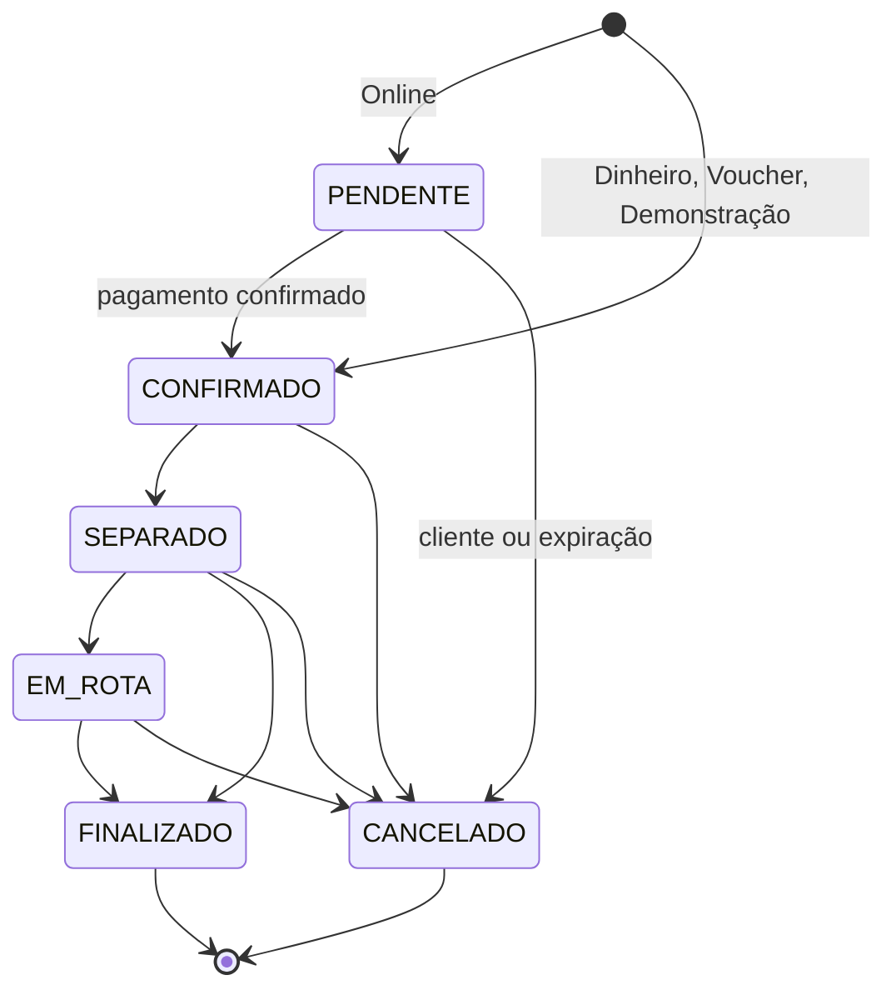
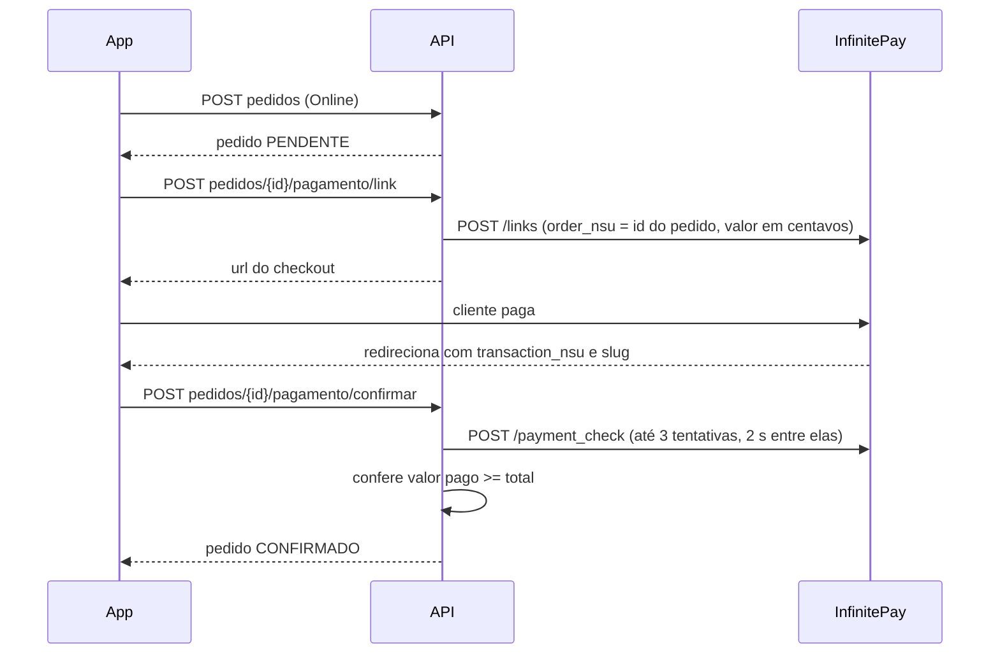

# 07. Regras de negócio

Cada regra aponta para a classe onde ela está implementada. Se mudar a regra, mude neste documento também.

## Faixa de validade e desconto (RN01)

Implementação: `ProdutoProcesso.AplicarRegras` (`SERVICE/Processo/ProdutoProcesso.cs`).

`dias = data de vencimento − hoje`, calculado em datas UTC, sem horas.

| Dias para vencer | Status | Desconto | Preço promocional |
|---|---|---|---|
| menor que 0 | `VENCIDO` | 0% | preço cheio |
| 0 a 10 | `VERMELHO` | `percentualDescontoVermelho` da loja (padrão 40%) | preço × (1 − desconto) |
| 11 a 20 | `AMARELO` | `percentualDescontoAmarelo` da loja (padrão 20%) | preço × (1 − desconto) |
| mais de 20 | `VERDE` | 0% | preço cheio |

- Os limites de **dias** (10 e 20) são constantes em `ConfiguracaoModel.DiasLimiteVermelho` e `DiasLimiteAmarelo`. Cada loja só configura os **percentuais**, em `configuracoes/{supermercadoId}`.
- O preço promocional é arredondado para 2 casas.
- `daysValidity` nunca fica negativo (vencidos gravam 0).
- O app Flutter tem uma cópia desta regra em Dart, com o padrão 20/40 fixo. Ao mudar a regra aqui, mude lá também, ou passe o app a usar só a API.

### Quando é recalculado

- Ao cadastrar e editar um produto (os valores são gravados no documento).
- A cada leitura pela API (painel e vitrine): o valor gravado é ignorado e recalculado.
- Uma vez por dia, pela rotina, que grava de novo `daysValidity`, `newPrice`, `status` e `descricaoPorcentual` nos produtos que mudaram. Isso existe para quem ainda lê o Firestore direto.

### Validação de produto

`ProdutoValidacao` (FluentValidation): nome obrigatório, preço maior que zero, preço de custo não negativo, quantidade não negativa, vencimento não pode estar no passado e URL de imagem obrigatória e válida.

### Ordem da listagem no painel

Primeiro os que têm estoque, depois os esgotados. Dentro de cada grupo: `VERMELHO`, `AMARELO`, `VERDE`, `VENCIDO`, e então pela data de vencimento.

## Dashboard

Implementação: `DashboardProcesso`.

- Contagem por status e de esgotados.
- **Valor em risco:** soma de `preço × quantidade` dos produtos com estoque em `VERMELHO` ou `AMARELO` (preço cheio).
- **Urgentes:** os 5 produtos com estoque e não vencidos que vencem primeiro.
- **Faturamento:** soma do `total` dos pedidos `FINALIZADO`.
- **Lucro:** soma de `subtotal do item − custo × quantidade` dos pedidos finalizados. Se algum item não tiver produto ou preço de custo, o lucro aparece marcado como incompleto (`LucroIncompleto`).

## Vitrine do app

Implementação: `VitrineProcesso`.

- Um produto aparece se tem loja, `quantidade > 0` e não está `VENCIDO`.
- A busca procura no nome, na marca e no nome da loja, sem diferenciar maiúsculas.
- Ordens: `vencimento` (padrão), `menorPreco`, `maiorDesconto` e `nome`.
- Os produtos são carregados todos e filtrados em memória (veja [Problemas conhecidos](12-problemas-conhecidos.md)).

## Pedidos

Implementação: `PedidoProcesso` e `StatusPedidoUtil`.

### Criação

1. Itens com o mesmo produto e a mesma origem (compra ou doação) são somados. Limites: ao menos 1 item, quantidade de 1 a 999 por item e no máximo 50 combinações de produto e origem.
2. O cliente precisa ter perfil (`POST api/app/clientes`) e não pode ser conta do painel.
3. Se houver itens de doação e um `ongId`, a ONG precisa existir e estar ativa.
4. Dentro de uma **transação do Firestore**, a API relê os produtos, recalcula preços e confere cada item. Motivos de recusa: produto não encontrado, sem loja, de outra loja (um pedido é de **uma** loja só), vencido ou estoque insuficiente. Havendo qualquer problema, nada é gravado e a resposta é `409` com o resumo.
5. Ainda na transação: baixa o estoque, debita o cashback usado e grava o pedido com `origemApi = true`.

O preço de cada item é sempre o calculado pela API. O app não envia preço.

### Cashback usado no pedido

`NivelFidelidadeUtil.CashbackMaximoPermitido`: o cliente pode usar até **15% do subtotal**, limitado ao saldo. Se pedir mais, o valor é reduzido sem erro.

### Forma de pagamento e estado inicial

| Forma | Status inicial | `paymentStatus` |
|---|---|---|
| `Dinheiro`, `Voucher` | `CONFIRMADO` | `a pagar na retirada` |
| `Online` | `PENDENTE` (estoque reservado) | `aguardando pagamento` |
| `Demonstracao` (só com `Pagamento:PermitirDemonstracao`) | `CONFIRMADO` | `pago` |
| Total zerado (até R$ 0,009) | `CONFIRMADO`, forma vira `Cashback` | `pago` |

Escolher `Cashback` como forma quando o saldo não cobre o total gera erro. Com o limite de 15%, na prática o total só zera em pedidos de valor quase nulo.

### Status

- A loja muda o status pelo painel. A loja não pode voltar um pedido para `PENDENTE`.
- `PENDENTE → CONFIRMADO` só acontece pela confirmação de pagamento, nunca pela loja.
- O cliente só cancela em `PENDENTE` ou `CONFIRMADO`.
- Toda mudança feita pela loja e toda confirmação de pagamento enviam push para os aparelhos do cliente.
- Textos antigos gravados pelo app ("Pagamento Pix Pendente", "Em preparação", "Entregue" etc.) são reconhecidos por `StatusPedidoUtil.Normalizar`.

### Cancelamento

- Pedidos criados pela API devolvem o estoque (uma vez só, controlado por `estoqueDevolvido`) e o cashback usado.
- Pedido pago online e depois cancelado fica com `estornoPendente = true`. O estorno é manual, no InfinitePay, e o painel mostra o aviso.

### Finalização e benefícios

Os benefícios só são creditados em `FINALIZADO`, uma única vez (`beneficiosAplicados`). Assim, um cancelamento nunca precisa desfazer nada.

- `totalDonations` do cliente aumenta pela quantidade de itens doados.
- **Cashback ganho** = valor doado × percentual do nível atual do cliente.
- **Impacto** é somado ao do cliente: itens resgatados (comprados), itens doados, economia (diferença entre preço cheio e preço pago nos itens comprados) e valor doado.
- Se o pagamento era "a pagar na retirada", passa para `pago`.

### Pagamento online (InfinitePay)

- A API nunca confia no app para dizer que pagou: ela sempre consulta o InfinitePay.
- Se o pagamento chegar depois de o pedido ter expirado, o pedido fica cancelado com `estornoPendente = true`, e o app recebe um erro explicando.
- Pedido online não pago é cancelado após `Pagamento:MinutosExpiracaoPedidoPendente` minutos (mínimo de 5).

### Pedidos antigos

Pedidos gravados pelo app direto no Firestore, antes da API, não têm `supermercadoId` nem `origemApi`. O painel os associa à loja procurando se algum item aponta para um produto dela. Eles não devolvem estoque nem recebem benefícios, porque o app antigo já tinha tratado isso.

## Fidelidade

Implementação: `NivelFidelidadeUtil`.

| Nível | Total de itens doados | Cashback sobre o valor doado |
|---|---|---|
| Bronze | 0 a 10 | 1% |
| Prata | 11 a 30 | 3% |
| Ouro | 31 ou mais | 5% |

O nível usado no cálculo é o do cliente **antes** de somar as doações do pedido que está sendo finalizado.

## Lojas e usuários

- **Código de acesso:** o nome da loja sem acentos, em minúsculas e só com letras e números. Se já existir, recebe um sufixo aleatório de 100 a 999 (`SupermercadoProcesso.GerarCodigoAcessoUnico`).
- **Cadastro:** cria o usuário no Firebase Auth, a loja e o administrador (`users`, com `perfil = ADMINISTRADOR`). Envia o código por e-mail; falha no e-mail não impede o cadastro.
- **Funcionários:** senha com hash PBKDF2-SHA256, 100.000 iterações, salt de 16 bytes, gravada como `iteracoes.salt.hash` (`SenhaHasher`). Funcionário inativo não aparece no login.
- **Dados da loja:** nome obrigatório; latitude e longitude precisam vir juntas. Ao mudar o nome, o `storeName` de todos os produtos da loja é atualizado.

## Rotinas em segundo plano

Implementação: `RotinaDiariaService` (agenda) e `RotinaProcesso` (trabalho).

| Rotina | Frequência | O que faz |
|---|---|---|
| Expirar pedidos | A cada execução (15 min) | Cancela pedidos online pendentes vencidos. |
| `recalculo-produtos` | 1 vez por dia | Regrava os campos derivados dos produtos que mudaram. |
| `notificacao-ofertas` | 1 vez por dia | Conta os produtos disponíveis que entraram hoje na faixa vermelha (`daysValidity == 10`) e, se houver pelo menos um, manda um push para o tópico de ofertas. |

O dia é calculado no fuso `America/Sao_Paulo`. A última execução fica em `rotinas/{nome}`.
