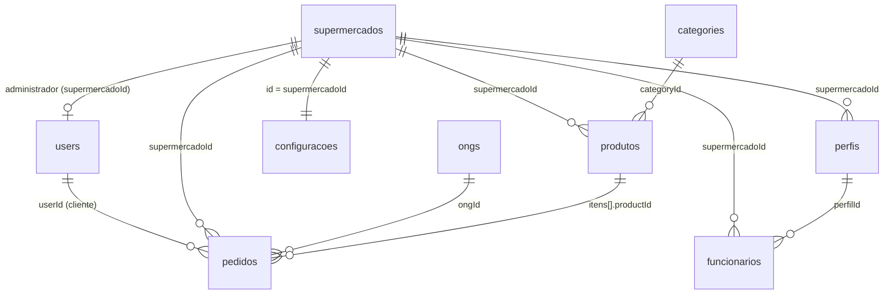

# 08. Modelo de dados (Firestore)

O Firestore é um banco NoSQL de documentos. Não há esquema nem chaves estrangeiras: as "relações" são campos com o id de outro documento, e quem garante a consistência é a API.

Os nomes dos campos no banco não são os nomes das propriedades C#. O mapeamento é feito com `[FirestoreProperty("nome")]` nos models do `DOMAIN`. Vários campos estão em inglês porque foram criados primeiro pelo app Flutter; **não renomeie** sem migrar os dados e o app.



## Coleções

### `supermercados`

Uma loja. Id gerado pelo Firestore. Model: `SupermercadoModel`.

| Campo | Tipo | Observação |
|---|---|---|
| `nome` | string | |
| `cnpj` | string | Opcional, sem validação de formato |
| `endereco` | string | |
| `codigoAcesso` | string | Único. Usado no login |
| `latitude`, `longitude` | number | Opcionais. O app usa para mostrar distância |

### `produtos`

Model: `ProdutoModel`.

| Campo | Propriedade C# | Tipo | Observação |
|---|---|---|---|
| `name` | `Nome` | string | |
| `brand` | `Marca` | string | |
| `categoryId` | `CategoriaId` | string | Id em `categories` |
| `oldPrice` | `Preco` | number | Preço cheio |
| `precoCusto` | `PrecoCusto` | number | Opcional, usado no lucro |
| `newPrice` | `PrecoPromocao` | number | **Derivado** |
| `descricaoPorcentual` | `DescricaoPorcentual` | int | **Derivado**: desconto em % |
| `daysValidity` | `DiaValidade` | int | **Derivado** |
| `status` | `Status` | string | **Derivado**: `VERDE`, `AMARELO`, `VERMELHO`, `VENCIDO` |
| `dateVenc` | `DataVencimento` | timestamp | |
| `quantidade` | `Quantidade` | int | Estoque |
| `urlImagem` | `UrlImagem` | string | |
| `supermercadoId` | `SupermercadoId` | string | |
| `storeName` | `NomeSupermercado` | string | Cópia do nome da loja (desnormalizado para a vitrine) |

Campos derivados são gravados para compatibilidade, mas a API sempre recalcula na leitura. Veja [regras](07-regras-de-negocio.md#faixa-de-validade-e-desconto-rn01).

### `users`

Coleção compartilhada por **dois tipos** de documento. É o ponto mais confuso do modelo.

| Tipo | Id | Como identificar | Model |
|---|---|---|---|
| Administrador de loja | Gerado pelo Firestore | Tem `supermercadoId` e `perfil = "ADMINISTRADOR"` | `UsuarioModel` |
| Cliente do app | `uid` do Firebase Auth | Sem `supermercadoId` | `ClienteModel` |

Campos do administrador: `email`, `fullName`, `supermercadoId`, `perfil`, `createdAt`.

Campos do cliente:

| Campo | Tipo | Observação |
|---|---|---|
| `fullName`, `email`, `phone` | string | |
| `address` | map | `cep`, `street`, `number`, `complement`, `neighborhood`, `city`, `state` |
| `totalDonations` | int | Itens doados em pedidos finalizados |
| `availableCashback` | number | Saldo. Alterado com `FieldValue.Increment` |
| `favoritos` | array de string | Ids de produtos |
| `fcmTokens` | array de string | Tokens de push |
| `impact` | map | `itemsRescued`, `itemsDonated`, `savedReais`, `donatedReais`, `methodologyVersion` |

### `funcionarios`

Model: `FuncionarioModel`. Campos: `nome`, `senhaHash`, `supermercadoId`, `perfilId`, `perfil` (nome do perfil, legado) e `ativo`.

### `perfis`

Model: `PerfilModel`. Campos: `nome`, `supermercadoId`, `permissoes` (array) e `chaveLegada`. Os perfis padrão têm id `{supermercadoId}_{gerente|operadorestoque|atendente}`.

### `configuracoes`

Id = `supermercadoId`. Campos: `supermercadoId`, `percentualDescontoAmarelo`, `percentualDescontoVermelho`. Se o documento não existir, valem 20 e 40.

### `pedidos`

Model: `PedidoModel`. Id gerado pela API antes da transação.

| Campo | Observação |
|---|---|
| `userId` | `uid` do cliente |
| `supermercadoId` | Ausente em pedidos antigos |
| `itens` | Lista: `productId`, `name`, `quantity`, `unitPrice`, `originalUnitPrice`, `subtotal`, `origin` (`compra`/`doacao`), `isDonation` |
| `subtotal`, `cashbackUsed`, `total` | Valores em reais |
| `hasDonations`, `donationItemsCount`, `donationSubtotal`, `ongId` | Doações |
| `formaPagamento` | `Dinheiro`, `Voucher`, `Online`, `Cashback`, `Demonstracao` |
| `paymentMethod` | Forma de pagamento gravada pelo app antigo |
| `pagamentoOnline` | bool |
| `paymentStatus` | `aguardando pagamento`, `pago`, `a pagar na retirada`, `cancelado` |
| `payment` | map com os dados do InfinitePay (`transactionNsu`, `slug`, `paidAmountCents` etc.) |
| `status` | Veja [status](07-regras-de-negocio.md#status) |
| `timestamp`, `atualizadoEm` | Datas |
| `endereco` | Texto |
| `impact` | Impacto do pedido |
| `origemApi` | `true` quando criado pela API |
| `cashbackEarned`, `beneficiosAplicados`, `estoqueDevolvido`, `estornoPendente` | Controle de efeitos colaterais, para nada ser aplicado duas vezes |

### `categories`

Compartilhada entre lojas. Campos: `name`, `icon` (número do ícone usado pelo app) e `order`.

### `ongs`

Compartilhada. Campos: `nome`, `descricao`, `cidade`, `urlImagem` e `ativa`.

### `rotinas`

Controle interno das rotinas diárias. Id = nome da rotina (`recalculo-produtos`, `notificacao-ofertas`). Campos: `ultimaExecucao` (data `yyyy-MM-dd`) e `atualizadoEm`.

## Índices

As consultas usam só igualdade em um campo (`supermercadoId`, `userId`, `status`, `codigoAcesso`, `email`), que o Firestore indexa automaticamente. Se você criar uma consulta com dois filtros ou com ordenação, o Firestore vai pedir um índice composto e mostrar o link para criá-lo no erro.

## Regras de segurança do Firestore

A API usa uma conta de serviço e **ignora** as regras de segurança. As regras só afetam o app, que ainda lê e grava algumas coisas direto no Firestore. Quando o app passar a usar só a API, as regras podem bloquear tudo:

```
rules_version = '2';
service cloud.firestore {
  match /databases/{database}/documents {
    match /{document=**} { allow read, write: if false; }
  }
}
```

Atenção: o login do app continua no Firebase Auth, que não depende dessas regras.
