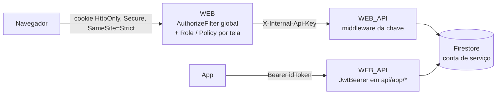

# 09. Segurança

## Identidades

| Quem | Onde autentica | Credencial guardada em |
|---|---|---|
| Administrador da loja | Firebase Auth (REST `signInWithPassword`, chamado pela API) | Firebase Auth |
| Funcionário | API, comparando hash | `funcionarios.senhaHash` (PBKDF2-SHA256, 100.000 iterações, comparação em tempo constante) |
| Equipe IValid | Firebase Auth + lista `Plataforma:EmailsAdministradores` | Firebase Auth |
| Cliente do app | Firebase Auth, direto pelo app | Firebase Auth |

## Camadas de proteção

1. **Painel:** um `AuthorizeFilter` global exige login em todas as páginas. Só `AutenticacaoController` é `[AllowAnonymous]`. Cada tela ainda exige um papel (`Roles`) ou uma permissão (`Policy`). Veja [Painel web](06-painel-web.md#perfis-e-permissões).
2. **Painel → API:** o middleware em `WEB_API/Program.cs` exige `X-Internal-Api-Key` em tudo, exceto `api/app/*`, `/openapi` e `/scalar`.
3. **App → API:** `JwtBearer` valida emissor, público (`ProjectId`) e validade do token do Firebase. A identidade sai do token (`user_id`).
4. **API → Firestore:** conta de serviço com acesso total; as regras de segurança do Firestore não se aplicam a ela.

### Isolamento entre lojas

A API confia no `supermercadoId` que recebe na query string. Quem garante que é o da loja do usuário é o painel, que lê o valor da claim do cookie. Por isso, **quem tem a chave interna tem acesso a todas as lojas**. A chave nunca pode ir para o navegador nem para o app.

A API confere a posse em cada operação por id (produto, pedido, funcionário, perfil): se o recurso não for da loja informada, responde "não encontrado".

### Outras proteções que já existem

- Formulários com `[ValidateAntiForgeryToken]`.
- "Esqueci a senha" responde sempre igual, exista ou não o e-mail.
- Login da plataforma devolve a mesma mensagem para e-mail fora da lista e senha errada.
- Se o cadastro falhar depois de criar o usuário no Firebase, o usuário é excluído (sem contas órfãs).
- Preço, estoque e confirmação de pagamento são decididos pela API, nunca pelo app.
- Benefícios e devoluções têm marcadores (`beneficiosAplicados`, `estoqueDevolvido`) para não serem aplicados duas vezes.

## Segredos

| Segredo | Onde fica hoje | Versionado? |
|---|---|---|
| Credencial da conta de serviço | `Chave/Chave_Firebase.json` | Não (`.gitignore` e `.dockerignore`) |
| Chave interna (desenvolvimento) | `appsettings.Development.json` de `WEB` e `WEB_API` | **Sim**, com o valor de desenvolvimento |
| Chave interna (produção) | Variável de ambiente no Render | Não |
| Senha do SMTP | `Email:SenhaRemetente` | Hoje só há um valor de exemplo |
| *Web API key* do Firebase | `WEB_API/appsettings.json` | Sim |
| InfiniteTag | `WEB_API/appsettings.json` | Sim (não é secreta) |

Regras:

- Em produção, a chave interna **precisa** ser diferente da de desenvolvimento, porque a de desenvolvimento está no Git.
- A *Web API key* do Firebase não é um segredo (ela vai dentro de qualquer app Firebase), mas deve ter restrições de uso no Google Cloud Console.
- Nunca faça commit de `Chave/`, de senhas de e-mail ou de chaves de produção. Use variáveis de ambiente.

## Riscos conhecidos

| Risco | Impacto | Sugestão |
|---|---|---|
| Chave interna única e com acesso total | Vazou, perdeu o isolamento entre lojas | Trocar por um token por usuário (JWT emitido no login) e validar a loja na API |
| Cadastro de loja aberto | Qualquer pessoa cria lojas e aparece na vitrine | Aprovação pela plataforma ou convite |
| Sem limite de tentativas no login de funcionário | Força bruta de senha | `AddRateLimiter` nas rotas de login |
| Tela de login lista os nomes dos usuários da loja a partir do código | Descoberta de nomes | Aceitável para o TCC; em produção, pedir usuário e senha |
| `ProdutoController` e `FuncionarioController` da API devolvem `ex.Message` em erro inesperado | Pode expor detalhes internos | Migrar para `ControllerApiBase` |
| Lista de e-mails da plataforma em configuração | Trocar exige redeploy | Aceitável para o tamanho da equipe |
